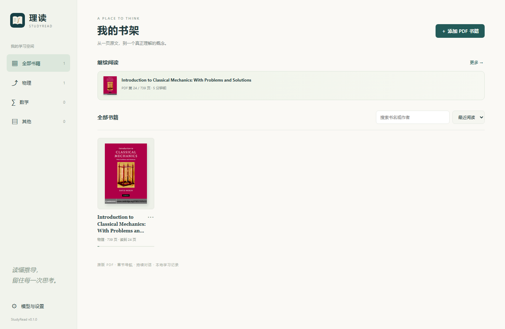
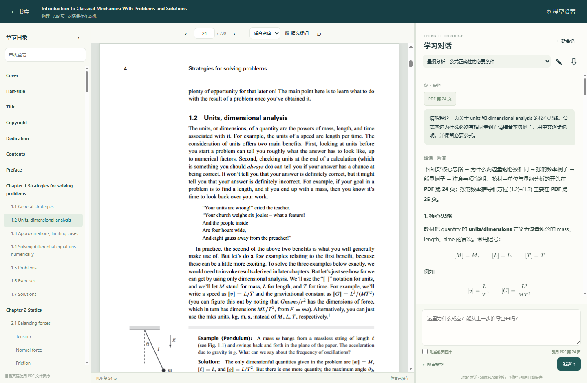
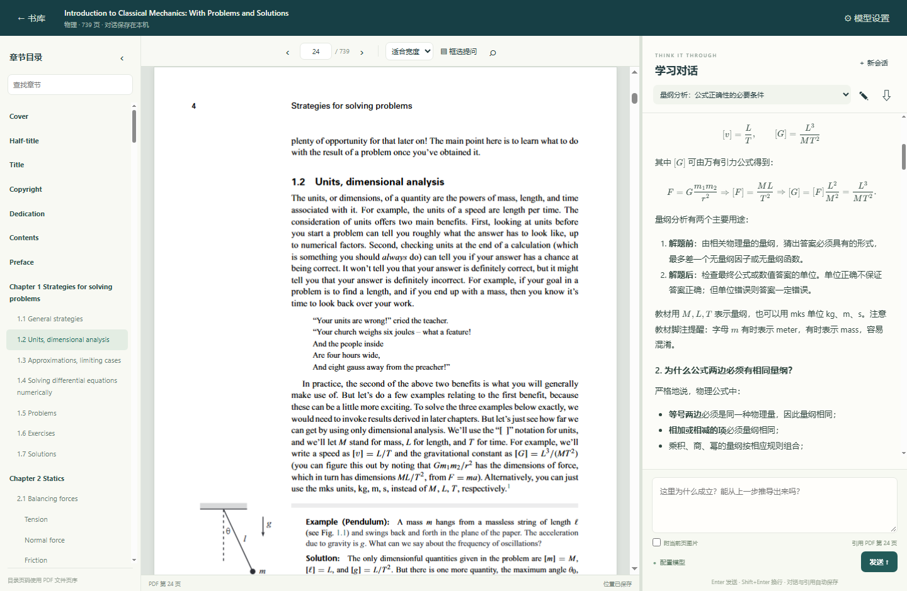

# 理读 · StudyRead

面向数学、物理原版 PDF 教材的桌面阅读助手：保留原版公式与图示，在旁边持续提问、推导和讨论。

与用于英文外刊的 [刊读](https://github.com/haithink/magread-desktop) 分开维护。
理读不生成整书摘要，重点是 **原版 PDF + 章节导航 + 可持续的学习对话**。

## 实际界面

以下截图来自 David Morin 的《Introduction to Classical Mechanics: With Problems and Solutions》。
右侧是围绕量纲分析实际生成并保存的连续问答；点击图片可查看原尺寸。

书库与最近阅读：

[](docs/screenshots/studyread-library.png)

原版教材、章节目录与持续会话：

[](docs/screenshots/studyread-reader.png)

推导讲解与数学公式排版：

[](docs/screenshots/studyread-math.png)

## 使用

1. 添加 PDF；书籍按内容去重，封面和目录自动提取，可在书籍菜单修改名称与分类。
2. 点击书籍直接阅读。左侧目录跳章，中间显示原版 PDF，右侧是当前书籍的学习会话。
3. 选中文字后点击「加入提问」，或点「框选提问」圈出公式、图示。也可以直接针对当前页提问。
4. 继续追问会带上此前的推导；每本书默认恢复上次会话，需要独立主题时点「新会话」。
5. 阅读位置和对话自动保存在本机。首页的「继续阅读」可直接回到上次阅读位置。

输入框支持 **Ctrl+V 粘贴剪贴板图片**：例如先用 Windows 截图快捷键 `Win+Shift+S`，
再回到输入框粘贴。每条问题最多 4 张，发送前有缩略图，可移除；也可只发图片，使用默认的讲解问题。
图片随已发送的问题保存在本机会话中，重新打开可查看，导出 ZIP 时也会包含图片。
使用图片模型连续追问时，会带上请求预算内最近一次带图问题的图片。

「附引用页整页截图」会在本次提问时另外附上右下角引用页码对应的整页 PDF 截图，
帮助模型识别公式、排版和图示。未勾选时默认只发送附近页文字；框选时自动发送框选区域截图。
粘贴图片可与选中文字、框选区域或整页截图一同发送。所有图片提问均需支持图片的模型。

模型设置支持 OpenAI 兼容和 Anthropic 原生接口，可一键导入本机刊读的配置。
文字问题可用 DeepSeek 等文字模型；公式截图和图示须选择实际支持图片的模型，并勾选图片能力。
回答支持 Markdown、LaTeX 数学排版、停止生成、失败重试；会话可导出为含引用截图的 Markdown ZIP。

## Windows 开发运行

需要 Python 3.11+、Node.js 24+（仅准备前端资源时需要）和 Microsoft Edge WebView2 Runtime。

```powershell
python -m venv .venv
.venv\Scripts\python.exe -m pip install -r requirements.txt
npm ci --omit=optional --ignore-scripts
npm run vendor
.venv\Scripts\python.exe main.py
```

也可传入 PDF 文件路径，首次启动时加入书库：

```powershell
.venv\Scripts\python.exe main.py "E:\books\Mechanics.pdf"
```

打包（输出免安装目录和 ZIP）：

```powershell
.venv\Scripts\python.exe tools\build.py
```

## 数据与上下文

数据目录为 `%LOCALAPPDATA%\StudyRead`，与刊读独立。`settings.json` 含本机 API 密钥；
`library.sqlite3` 保存阅读位置和会话，`books` 保存 PDF 副本，`attachments` 保存提问截图。
备份时先关闭程序，复制整个数据目录。原始教材不会加入源码仓库或发行包。

提问只发送选中内容、引用页附近的文字、最近若干轮会话以及明确附上的图片；不上传整本书。
历史全文长期保留在本机；长会话的请求按预算保留最近完整问答轮次，不宣称无限模型上下文。
当前页最多约 10,000 字符，相邻两页各约 3,500 字符，历史请求预算约 42,000 字符。
公式的文字提取可能丢失排版，遇到复杂公式宜框选并使用支持图片的模型。

## 验证

```powershell
.venv\Scripts\python.exe -m pip install -r requirements-dev.txt
.venv\Scripts\python.exe -m pytest tests -q
$env:CHROME_PATH = "C:\path\to\chrome.exe"
node --test tests\browser.test.cjs
.venv\Scripts\python.exe tools\native_smoke.py
```

`STUDYREAD_SAMPLE_PDF` 可指定实际教材用于浏览器集成测试。
测试使用临时书库和本地模拟模型，不消耗个人 API 额度。
开发时可用 `STUDYREAD_DATA_DIR` 指定独立数据目录；`main.py --serve` 可仅启动本地服务用于浏览器调试。

设计说明见 [DESIGN.md](DESIGN.md)，第三方资源见 [THIRD_PARTY_NOTICES.md](THIRD_PARTY_NOTICES.md)。
本项目源码采用 **AGPL-3.0-only**；第三方依赖保留各自许可证。
